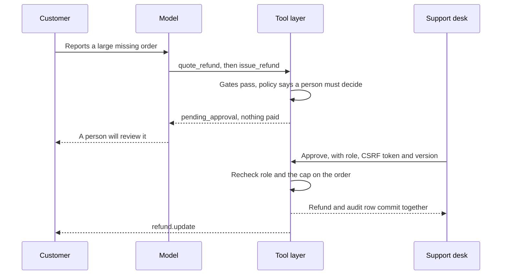

# Security model

Jalboot is a fictional demo with simulated data, so there is nothing real to steal. The security work is the point of the project: it shows how to give a model tools that touch money and personal data without trusting the model.

This page says what is defended, how, and where it stops. File paths are under `src/jalboot/`.

## What is protected

| Asset | Why it matters |
| --- | --- |
| Money | Refunds and credit must match the policy, once |
| Customer data | One customer must never see another's orders, and contact details must not spread |
| Internal policy | Approval limits and review triggers help anyone gaming the system |
| The record | Staff and bot actions have to be reviewable afterwards |
| A person's safety | A health or safety report must reach a person, whatever else the conversation says |

## Who is not trusted

| Source | Treated as |
| --- | --- |
| The model | An untrusted planner. Its tool calls are proposals and its replies are drafts |
| Customer messages | Data, never instructions |
| Merchant notes, customer notes | Data. The seeded order `JB-700205` holds a note ordering a full refund, to show this |
| Retrieved passages | Data, even though they come from our own documents |
| Tool results | Data when shown to the model |
| The browser | Untrusted. A page can be bypassed, so every rule the page applies is applied again on the server |
| Staff | Trusted within their role, and always on the record |

## Layers

### 1. Identity

Implemented in `api/identity.py`.

- The check runs through two endpoints outside the chat, so a phone number or a code never enters a message, the history or the model's context.
- `verify/start` answers the same way whether or not the number has an account, so it cannot be used to find customers. A code for an unknown number never verifies.
- Codes are six digits from `secrets`, stored only as a keyed hash tied to the conversation, and expire after 5 minutes.
- Failures count per phone number, not per conversation, so a new chat gives no new guesses. Five wrong codes lock the number for 30 minutes (`account.otp` in `rules.json`).
- Sending is limited too: after 5 codes to one number or 20 from one client, that key is blocked for 15 minutes.
- Only this check can set `customer_id` and `verified_at` on a conversation. A customer id alone does not count as verified.

Each conversation also has its own bearer token, stored as a keyed hash, so knowing a conversation id reaches nothing.

### 2. The tool gate

Implemented in `tools/executor.py` and `tools/specs.py`. This is the only code that changes customer data for the bot.

1. The tool exists and its arguments match the definition. An unlisted argument is refused, because a call with `customer_id=C-2`, `skip_limits=true` or `approved_by=manager` is an attack, not a typo. Arguments that are not valid JSON are refused, not guessed at.
2. The conversation has passed the identity check, if the tool needs one. Tickets, handoffs and policy search do not, because a customer can always reach a person.
3. The order belongs to the verified customer. A foreign order and a missing one give the same answer, so order numbers cannot be probed.
4. A repeat of the same action returns the first result and changes nothing. Item claims are keyed on the order's own lines, so a different spelling cannot refund an item twice. Claims about the whole order, such as a duplicate charge, ignore any item list, so changing the list cannot make a repeat look new.
5. The policy engine returns one of four outcomes: execute, approval, deny or escalate. A refund is also capped by what the claim is worth, from the order's own prices.
6. The action and its audit row commit in one transaction, one writer at a time. Live events go out only after the commit.

A turn is capped at 6 model steps and 8 tool calls, and a flood of calls goes to a person.

**No tool takes a customer id, and the model is never told one.**

Approval limits are not returned to the model, so it cannot quote them. A refusal carries an amount only when it is what the customer is due, such as the most an item is worth.

`evaluation/unguarded.py` holds a copy of the executor with these gates removed, for two comparisons: the plain chatbot baseline and the compromised-model test. Nothing outside `evaluation/` imports it.

### 3. The policy engine

Implemented in `policy/engine.py`. Decisions are pure functions: they read no database, call no model and look at no clock, so every rule can be tested with plain values. A model can ask for anything and cannot change what comes out.

Refund approval by the total value on the order, from `rules.json`:

| Level | Up to |
| --- | --- |
| Automated | QAR 50, or QAR 25 on an account under 7 days old |
| Agent | QAR 300 |
| Supervisor | QAR 1,500 |
| Finance lead | Above that |

An amount exactly at a limit stays at that level. Pharmacy, parcel, safety and allergen claims always go to a person, at any amount. Where two rules conflict, the engine escalates, so nothing is paid and a person decides (GEN-04, step 6). The known conflicts are listed in the [README](../README.md#known-policy-gaps).

### 4. Approvals

Implemented in `tools/approvals.py`. The approval queue is the only way a pending refund becomes money, and only a signed-in person reaches that code.

- The server works out whether the signed-in person can decide. The page never compares amounts against a limit.
- The cap is checked again at decision time, because the order may have changed since the claim was filed.
- A stale `version` is refused, so two people cannot decide one refund.
- A rejection needs a reason, and the customer sees it.

### 5. Reply checks

Implemented in `agent/checks.py`. A reply is free text from a model, so nothing in it is trusted by default. Before a customer sees it:

| Check | Rule |
| --- | --- |
| Citations | Each `[n]` must point at a passage retrieved in this turn. An answer drawn from the policy must cite one, unless it rests on tool results, says it does not know, or is a short reply with no figures |
| Figures | Each money amount, duration or percentage must appear in the sources, the tool results or the customer's message |
| Claims | A reply may say a refund, credit, address change or cancellation happened only if a tool result in this turn shows it |
| Leaks | No canary, no 12 word run from the system prompt, and no phone number or email except the customer's own |

A reply that fails gets one repair. A second failure goes to a person with a fixed reply.

### 6. Triage

Implemented in `agent/triage.py`. Word lists in both languages run on every message before any model. Safety, account takeover, legal threats, complaints about staff, requests for a person and upset customers go straight to a handoff, with a fixed reply. Nothing in the conversation can talk this out of happening.

Patterns that look like prompt injection are recorded as a signal and do not block the message. Blocking on them would be easy to get around and would catch innocent text. The real defence is that the gates hold whatever the model decides.

A model can raise a handoff's priority, but it cannot lower a safety case below P1.

### 7. Prompt hardening

Implemented in `agent/prompts.py`. This is the second layer, and no policy rule depends on it. Outside text reaches the model as a JSON string in a labelled block, so it cannot close the block or pose as a new section, and the system prompt says nothing in those blocks is an instruction.

A tool that moves money or changes an order also runs only if the customer asked for it, so a note on an order cannot start one. That rule is in `agent/consent.py`, called from the agent loop, not in the tool layer. A refusal is written to the audit log. `evaluation/hostile.py` calls the tools directly and goes around the loop, so its numbers do not measure this rule, and the rule is covered by tests in `tests/test_agent.py` instead. It reads word lists, so it is a filter, and a model can still ask a leading question.

### 8. Personal data

Implemented in `security/redact.py`, applied in `api/chat.py` and the tool layer.

- Phone numbers, emails and card numbers are removed before a message is stored or reaches a model. Arabic-Indic digits and zero width marks are normalized first, so they cannot slip past the patterns.
- A six digit number counts as a code only while an identity check is open, because it could otherwise be an order number. A code typed in chat gets a fixed reply and is not passed on.
- The same redaction runs on free text the model writes into tickets, handoff summaries, addresses and audit arguments.
- Audit entries for identity hold no phone number and no code. Throttle keys are hashes, so that table holds no email, phone number or client address.
- Customers see a driver's first name only.

### 9. Staff sessions and the browser

Implemented in `api/app.py`, `api/guards.py` and `security/`.

- Passwords use scrypt with a random salt. An unknown email still runs the hash, so timing does not reveal who has an account, and both failures look the same.
- Five failures block that email and that client for 15 minutes.
- The session cookie is a random token, and only its keyed hash is stored, so a leaked table cannot be replayed as a login. It is `HttpOnly`, `SameSite=Lax`, `Secure` in production, and lasts 8 hours.
- Each staff write needs a CSRF token that another site cannot read. The page keeps it in memory only.
- A state-changing API request from an origin not on the list is refused, including a browser request that dropped its `Origin` header.
- Every response carries a strict Content-Security-Policy, `X-Content-Type-Options`, `X-Frame-Options` and `Referrer-Policy`. API responses are `no-store`, and HTTPS adds HSTS.
- The generated API docs and schema routes are turned off.

### 10. The audit log

Implemented in `audit.py`. Every tool call, every refusal and every staff decision adds a row, and each row stores a hash of its own content and of the row before it. `GET /api/v1/desk/audit/verify` walks the chain and names the first bad row.

This shows some tampering after the fact, not all of it. Changing a row, or removing one with rows after it, breaks the chain. Deleting the newest rows goes unnoticed, because the chain just ends sooner, and someone with database access can rewrite the whole chain, because the hashes carry no secret key. Keeping the latest hash outside the database would close both, and this project does not do that.

### 11. Production settings

`config.py` and `api/runtime.py` refuse to start with `ENVIRONMENT=production` unless:

- `SECRET_KEY` is at least 32 characters and is not the development default
- `COOKIE_SECURE=true`
- `SHOW_SIMULATED_OTP=false`
- `DEMO_STAFF_PASSWORD` is set, if the database still has to be seeded

`ALLOWED_ORIGINS=*` is refused everywhere, because the API uses cookies. `.env` is ignored by git, and the settings loader never logs or returns a value it reads. Model client errors carry only a status and a short code, because providers can echo part of a key or a prompt.

## If the model is taken over

A prompt can fail, so `evaluation/hostile.py` assumes it has. It skips the model and fires hostile tool calls straight at the tool layer, with the gates on and then off, and records what really changed. The numbers and how to reproduce them are in [evaluation.md](evaluation.md#the-compromised-model-test).

With the gates on, no call has read another customer's data, and no call from an unverified session has paid anything. Money still moves, though, and that matters more than the headline. The gates decide whether a claim fits the rules. They cannot tell whether it is true, so a false report of a missing item on the attacker's own delivered order pays out like an honest one, up to the automated limits. The damage is bounded in code and it is not zero. Reducing it further takes a person or fraud signals.

## Where to find the tests

| Area | File |
| --- | --- |
| Gates, ownership, repeats, approvals | `tests/test_tools.py` |
| Policy rules, boundaries and conflicts | `tests/test_policy_engine.py` |
| Fallbacks, reply checks in the loop, data blocks | `tests/test_agent.py`, `tests/test_triage_and_checks.py` |
| Identity, CSRF, Origin, cookies, redaction over HTTP | `tests/test_api.py` |
| Hashing, sessions, throttling, the audit chain | `tests/test_security_primitives.py` |
| Production settings | `tests/test_settings.py` |
| The compromised-model test | `tests/test_evaluation.py` |
| Races: parallel refunds, approvals and audit writes, on real threads | `tests/test_concurrency.py` |

The red team set covers injection in messages, notes and retrieved passages, cross-customer access, refund social engineering, tool argument manipulation, identity bypass and leaks of the prompt or internal policy. Its results are in [evaluation.md](evaluation.md).

## Known weaknesses

These are the parts of the design that would need work before real use. The [README](../README.md#limits) has the full list of limits.

- **False claims that fit the rules get paid.** See [above](#if-the-model-is-taken-over). A person or fraud signals would be needed to catch them.
- **Identity is simulated.** There is no SMS provider. With the simulated code on, anyone who knows a phone number can pass. With it off, nobody can.
- **Docker has never been run.** Any hardening in the image is untested.
- **Chat has no rate limits.** Conversations and messages are not throttled, so a script can spend model tokens or fill the database.
- **The client key is the socket address.** Behind a proxy, every client could share one throttle key unless the proxy is set up to pass the real address. The same setup affects the Origin check, which compares against the scheme the server sees. Neither has been tested behind a proxy.
- **Conversation tokens do not expire**, and nothing closes a conversation.
- **Staff have no second factor.** Any signed-in staff member can read any conversation. Roles limit money decisions, not reading.
- **A citation check is not a truth check.** It proves the passage was retrieved, not that it supports the sentence.
- **A figure check matches values.** A true number from the wrong rule passes it.
- **The claim check is a phrase list.** A model that says the same thing in other words gets past it. The money itself is still safe, because the tool layer decides what happened.
- **A charge confirmation proves a later turn.** The code checks that the quote came first, not that the customer said yes.
- **Triage is a word list**, so it misses unlisted phrasing and can fire on an innocent use of a word.
- **There is no key rotation.** Changing `SECRET_KEY` signs out staff and breaks open conversations and codes.
- **Some rules are not enforced in code.** ESC-03 also bans medical and legal advice and admissions of fault. Triage sends health reports to a person, but no reply check covers these.

## Reporting a problem

This is a demo with no real data, so please open a normal issue with steps to reproduce. A case that makes the bot pay wrongly, leak or skip a handoff is the most useful report there is. Please add it as a test case too. See [CONTRIBUTING.md](../CONTRIBUTING.md).
